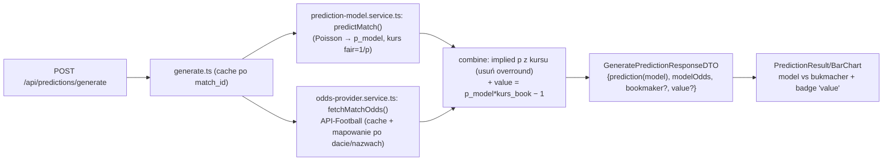

# Plan wdrożenia: hybrydowe prawdopodobieństwa i kursy (model + bukmacher)

## Uwagi z weryfikacji (Claude) — przeczytaj najpierw

Plan pochodzi z sesji Ultraplan (chmura). Zweryfikowałem go względem kodu. Stan ustaleń:

1. **Decyzja AI = ODŁOŻONA.** Plan w pkt. 6 zakłada _usunięcie_ LLM i zastąpienie modelem
   Poissona. To sprzeczne z wcześniejszym wyborem „tryb równoległy (obok AI)". Decyzja
   replace vs parallel **jeszcze nie podjęta** → **pkt 6 „Wycofanie LLM" jest WSTRZYMANY**
   do czasu decyzji. Reszta etapu 1 (model + kursy + value) może powstawać _obok_ AI.
2. **Dostawca kursów = tylko API-Football** (`api-sports.io/sports/football`). The Odds API
   **wycofane** z planu na życzenie użytkownika (usunięte z rekomendacji i źródeł).
3. **⚠️ Bezpieczeństwo — DO UZUPEŁNIENIA.** `src/pages/api/predictions/generate.ts` nadal **bez
   auth guard i bez rate-limit** (potwierdzone w kodzie; ryzyko z pamięci
   `predictions-endpoint-abuse-risk`). Plan dokłada do tej samej niezabezpieczonej ścieżki
   wywołania API-Football (limit **100 req/dzień**) i football-data → bot może drenować wiele
   limitów. **Przed wdrożeniem etapu 1 dograć**: auth guard + rate-limit (spójnie z
   `.ai/security-rate-limiting-plan.pl.md`).
4. **Gałąź `claude/math-learning-plan-rtduit` nie istnieje lokalnie** (jesteśmy na
   `vue3-migration`). Nazwę traktować jako historyczną z sesji chmurowej; gałąź roboczą ustalimy
   przy starcie implementacji.

**Zweryfikowane jako poprawne** (istnieją w repo): `src/lib/i18n/translations.ts`;
`LEAGUE_CODES` (PL/PD/BL1/WC) i `generatePredictionBodySchema` (`schemas.ts`, `types.ts:223`);
`BUSINESS_RULES.PREDICTION_CACHE_TTL_HOURS = 6` (`generate.ts:40`); `isPredictionProbabilities`
(`types.ts:270`); opis `generate.ts` (cache po `match_id`).

---

## Context (po co i co zmieniamy)

To **plan wdrożenia (z przebudową) kluczowego feature'u** projektu: realnego obliczania
prawdopodobieństw wyników i kursów dla meczów. Kupony są zaprojektowane, ale wdrażane w kolejnej
iteracji.

Stan obecny: `src/lib/services/ai-prediction.service.ts` prosi LLM (Llama 3.1‑70B) o trzy
liczby `{home, draw, away}`. To „zgadywanie" — niedeterministyczne i niewytłumaczalne.
`GET /api/predictions/generate` wywołuje ten serwis i cache'uje wynik po `match_id`.

**Kierunek: HYBRYDA.** Pokazujemy oba źródła:

1. **Model statystyczny (Poisson)** liczony z danych football-data.org → nasze prawdopodobieństwa
   i kurs fair (`1/p`).
2. **Kursy bukmachera** z API-Football → implikowane prawdopodobieństwo
   (`p ≈ 1/kurs` po usunięciu marży bukmachera / „overround").
3. **Wskaźnik „value"**: porównanie obu — gdy nasze `p` jest wyższe niż implikuje kurs
   bukmachera (`p_model * kurs_book − 1 > 0`), oznaczamy zakład jako wartościowy.

Ważne ustalenia z kodu:

- `league` w żądaniu generate to już kod kompetycji football-data
  (`generatePredictionBodySchema` → enum `LEAGUE_CODES` = `PL`/`PD`/`BL1`/`WC`).
- Kurs fair = `1/p` → zapis predykcji bez zmian w DB w etapie 1 (trzymamy
  `prediction_result` = prawdopodobieństwa modelu; kursy/implied/value liczymy w locie).
- W PRD (`.ai/prd.md:56`) kursy były świadomie poza MVP — to zamierzone rozszerzenie zakresu.

## Dostawca kursów: API-Football (api-sports.io)

- Darmowy plan: **100 zapytań/dzień, na stałe, bez karty**, dostęp do **wszystkich** endpointów,
  w tym **kursów pre-match (rynek 1X2)**; pokrycie 1200+ lig, w tym PL/PD/BL1.
- **Zapas:** Highlightly / OddsPapi (też darmowe tiery na kursy piłkarskie) — możliwe dzięki
  adapterowi (niżej) bez zmian w reszcie kodu.

**Haczyk integracyjny:** API-Football ma własne ID meczów/drużyn (≠ football-data.org). Mapowanie
naszego meczu → fixture z kursami robimy po **dacie meczu + znormalizowanych nazwach drużyn**
(okno czasowe ±1 dzień), z **fallbackiem „tylko model"** gdy brak dopasowania lub dostawca
niedostępny. Dlatego dostawca jest schowany za adapterem.

## Przepływ danych (etap 1, hybryda)

## Implementacja — etap 1

### 1. Model Poissona — `src/lib/services/prediction-model.service.ts` (nowy)

Czyste, testowalne funkcje + jedna funkcja I/O (standings). Błędy jak w
`football-data.service.ts` (`ExternalServiceError`).

- `fetchStandings(leagueCode, apiKey)` — `GET /v4/competitions/{code}/standings`, nagłówek
  `X-Auth-Token`; parsuje tabelę `type === "TOTAL"`. Cache `cache` (`cache.service.ts`),
  klucz `standings:{code}`, TTL ~24 h.
- `computeTeamStrengths(rows)` — atak/obrona drużyny vs średnia ligowa (GF/mecz, GA/mecz).
- `expectedGoals(...)` — `λ_home`, `λ_away` z przewagą gospodarza (stała v1; enhancement:
  tabele `HOME`/`AWAY`).
- `poissonMatrix(λ_home, λ_away, maxGoals=8)` — siatka wyników → `{home, draw, away}`, Σ=1.
- `probabilitiesToOdds(p)` — `{home:1/p.home, draw:1/p.draw, away:1/p.away}` (kurs fair).
- `predictMatch(matchData, apiKey)` — orkiestracja; dopasowanie drużyn po znormalizowanej nazwie;
  fallback‑prior z przewagi gospodarza, gdy brak drużyny w tabeli.

### 2. Dostawca kursów — `src/lib/services/odds-provider.service.ts` (nowy, adapter)

- `fetchMatchOdds({ homeTeam, awayTeam, league, matchDate }, apiKey)` — odpytuje API-Football
  (`/odds` lub `/fixtures` + `/odds`), mapuje fixture po dacie + nazwach drużyn (normalizacja),
  zwraca **kursy dziesiętne 1X2** `OutcomeOdds | null`. Cache klucz `odds:{match_id}`, TTL ~6 h.
  `null` = brak dopasowania/dostawca down → tryb „tylko model".
- `oddsToImpliedProbabilities(odds)` — `raw_i = 1/odds_i`; `overround = Σ raw`;
  `p_i = raw_i / overround` (usunięcie marży; enhancement: metoda Shin/power).
- Interfejs adaptera (np. typ `OddsProvider`) tak, by podmiana dostawcy nie ruszała endpointu.

### 3. Łączenie + „value"

W endpoincie (lub `combinePrediction()` helper): mając `p_model` i `kurs_book`:

- `impliedProb` z `oddsToImpliedProbabilities`.
- `value_i = p_model_i * kurs_book_i − 1` (>0 → zakład wartościowy; flaga w odpowiedzi).

### 4. Typy — `src/types.ts`

- `OutcomeOdds = { home:number; draw:number; away:number }`.
- `BookmakerInfo = { odds: OutcomeOdds; impliedProbability: PredictionProbabilities;
bookmaker?: string }`.
- `OutcomeValue = { home:number; draw:number; away:number }` (edge, dodatni = value).
- Rozszerzyć `GeneratePredictionResponseDTO`: `modelOdds: OutcomeOdds`,
  `bookmaker?: BookmakerInfo | null`, `value?: OutcomeValue | null`. `prediction` (model) bez
  zmian → kontrakt zapisu/DB nienaruszony. Reużyć `isPredictionProbabilities` (`src/types.ts:270`).

### 5. Endpoint — `src/pages/api/predictions/generate.ts`

- **NAJPIERW dograć auth guard + rate-limit** (patrz Uwaga 3 powyżej) — endpoint dokłada drogie
  wywołania zewnętrzne na niezabezpieczonej ścieżce.
- Wpiąć `predictMatch` (model) **+** `fetchMatchOdds` (kursy). _Decyzja replace-vs-parallel z AI
  odłożona_ — w wariancie równoległym model/kursy lecą obok istniejącego `generatePrediction`.
- Klucze z env: `FOOTBALL_DATA_API_KEY` (jak endpoint matches) oraz nowy `ODDS_API_KEY`
  (`locals.runtime?.env?.X || import.meta.env.X`).
- Zachować cache po `match_id`/TTL (`BUSINESS_RULES.PREDICTION_CACHE_TTL_HOURS`).
- Złożyć odpowiedź `{prediction, modelOdds, bookmaker, value}`; przy braku kursów →
  `bookmaker:null, value:null` (UI degraduje się do modelu).

### 6. Wycofanie LLM — ⏸ WSTRZYMANE (decyzja replace-vs-parallel odłożona)

- _Tylko jeśli wybierzemy „zastąpienie":_ usunąć użycie i plik
  `src/lib/services/ai-prediction.service.ts` (po grepie referencji), odpiąć `OPENROUTER_API_KEY`
  z tej ścieżki, zaktualizować README. **W trybie równoległym ten krok pomijamy.**

### 7. UI — model vs bukmacher + „value"

- `src/components/PredictionResult.vue`: w bloku sukcesu dodać sekcję kursów —
  kurs fair (model) i kurs bukmachera obok prawdopodobieństw; **badge „Value"** przy
  outcome z dodatnim `value` (i18n). Gdy `bookmaker:null` — pokaż tylko model + notkę „brak kursów".
- `src/components/BarChart.vue`: opcjonalnie kursy przy każdej z trzech opcji.
- `src/components/SavedPredictionsList.vue`: kurs fair z zapisanych prawdopodobieństw (`1/p`).
- i18n: nowe etykiety (`fairOdds`, `bookmakerOdds`, `value`, `noOdds`) w `pl`/`en`
  (`src/lib/i18n/translations.ts`; typ `Translation` wymusi komplet).

### 8. Konfiguracja / env

- Nowy sekret `ODDS_API_KEY` (API-Football). Dodać do `.env.example` i README; w Cloudflare
  jako secret (jak `FOOTBALL_DATA_API_KEY`).

### 9. Testy — `src/lib/services/__tests__/`

Vitest (`npm run test:unit`), wzorzec jak `prediction.service.test.ts`:

- `prediction-model.service.test.ts`: `poissonMatrix` Σ≈1; równe siły → `home>away` (przewaga
  gospodarza); silny gospodarz → wysokie `P(home)`; `probabilitiesToOdds` = `1/p`; fallback bez
  drużyny; `predictMatch` z zamockowanym `fetch`.
- `odds-provider.service.test.ts`: `oddsToImpliedProbabilities` — Σ implied = 1 po usunięciu
  overround, sensowne wartości; mapowanie fixture po nazwie/dacie (mock `fetch`); brak
  dopasowania → `null`; obliczenie `value` (dodatnie/ujemne).

## Kupony — projekt na kolejną iterację (NIE teraz)

- DB: `coupons` + `coupon_selections` (lub JSON), RLS jak `predictions`, migracja w
  `supabase/migrations/`.
- Matematyka: łączne `P = Π p_legi`; łączny kurs = `Π kurs_legi`; source p = model lub bukmacher
  (do wyboru). Reużycie `probabilitiesToOdds`.
- API `POST/GET/DELETE /api/coupons` + UI dodawania meczów i podsumowania.

## Pliki (etap 1)

| Plik                                                                                 | Zmiana                                                                                |
| ------------------------------------------------------------------------------------ | ------------------------------------------------------------------------------------- |
| `src/lib/services/prediction-model.service.ts`                                       | **nowy** — Poisson + kurs fair                                                        |
| `src/lib/services/odds-provider.service.ts`                                          | **nowy** — adapter kursów (API-Football) + implied/value                              |
| `src/lib/services/__tests__/prediction-model.service.test.ts`                        | **nowy** — testy modelu                                                               |
| `src/lib/services/__tests__/odds-provider.service.test.ts`                           | **nowy** — testy kursów/implied/value                                                 |
| `src/types.ts`                                                                       | `OutcomeOdds`/`BookmakerInfo`/`OutcomeValue` + pola w `GeneratePredictionResponseDTO` |
| `src/pages/api/predictions/generate.ts`                                              | auth guard + rate-limit, model + kursy, env keys, złożenie odpowiedzi                 |
| `src/lib/services/ai-prediction.service.ts`                                          | ⏸ usunięcie tylko w wariancie „zastąpienie" (decyzja odłożona)                       |
| `src/components/PredictionResult.vue` (+ `BarChart.vue`, `SavedPredictionsList.vue`) | model vs bukmacher + badge value                                                      |
| `src/lib/i18n/translations.ts`                                                       | etykiety kursów/value (`pl`/`en`)                                                     |
| `.env.example`, `README.md`                                                          | `ODDS_API_KEY`, opis modelu + kursów                                                  |

Bez migracji DB w etapie 1. Nowa zależność: brak (zwykły `fetch`); nowy sekret `ODDS_API_KEY`.

## Weryfikacja

1. `npm run test:unit` — model (Σ=1, przewaga gospodarza, fallback) i kursy
   (implied Σ=1 po overround, mapowanie, `null`, value) przechodzą.
2. `npm run lint` — czysto (strict TS).
3. Manualnie (`npm run dev`, z `ODDS_API_KEY`): generacja meczu PL/PD/BL1 → widoczne
   prawdopodobieństwa modelu **i** kurs fair **i** kurs bukmachera + ew. badge „Value";
   suma `home+draw+away ≈ 1`.
4. Sanity bez `ODDS_API_KEY` / poza sezonem / brak dopasowania fixture → odpowiedź degraduje się
   do „tylko model" (bez 500), UI pokazuje notkę o braku kursów.

## Po zatwierdzeniu

Gałąź roboczą ustalić przy starcie implementacji (nazwa `claude/math-learning-plan-rtduit` z sesji
chmurowej nie istnieje lokalnie). Commit + push. PR tylko na wyraźną prośbę.

## Źródła (dostawca kursów)

- API-Football — darmowy plan 100 req/dzień, kursy pre-match:
  https://www.api-football.com/pricing , https://api-sports.io/sports/football
- Porównania: https://oddspapi.io/blog/odds-api-pricing-2026-comparison/ , https://jedibets.com/sports-odds-api
- Alternatywa darmowa na kursy piłkarskie: https://highlightly.net/football-api/
